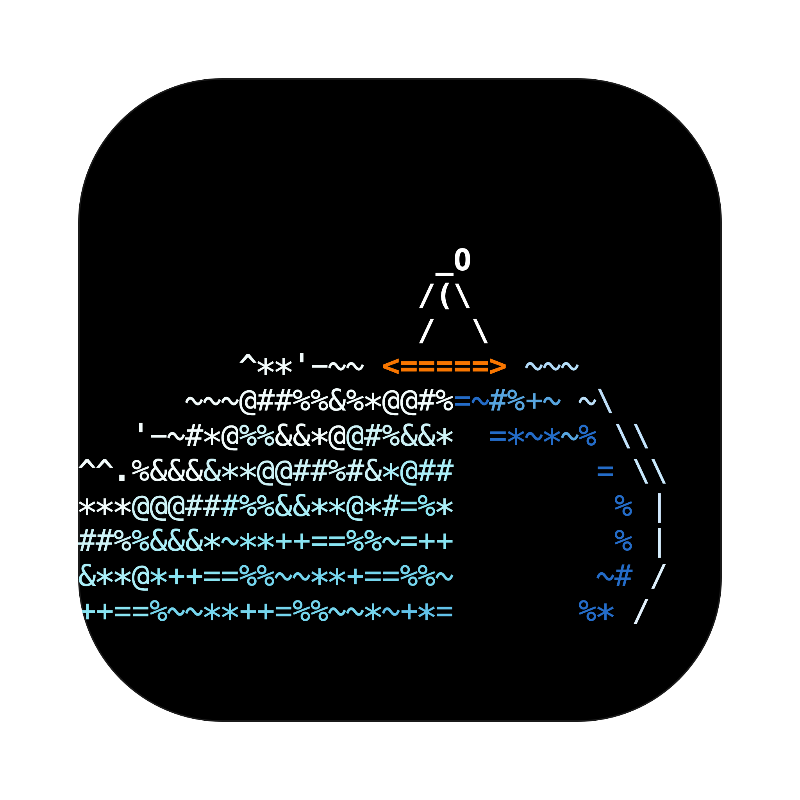
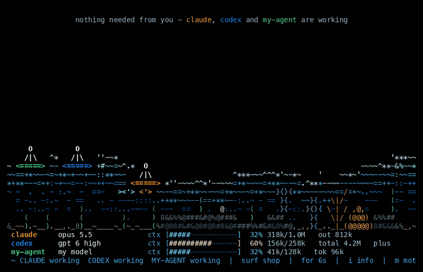
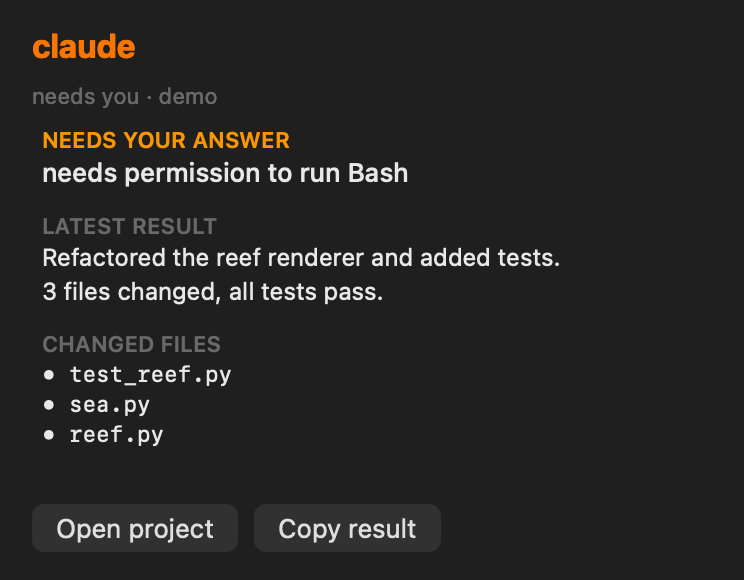

<p align="center">
  
</p>

<h1 align="center">Lineup</h1>

<p align="center">
  <b>Your AI agents are out there working. Watch them surf.</b><br>
  A tiny always-on-top ocean where every coding agent you run is a surfer,<br>
  and the sea itself tells you who's busy, who's done, and who needs you.
</p>

<p align="center">
  
</p>

---

## Why you'll want this

You started Claude Code on one task, Codex on another, maybe a third agent in a terminal somewhere.
Then you did what everyone does: **alt-tabbed back every 40 seconds to check on them.**

Lineup ends that.

- 🚩 **You find out the second an agent needs you.** Permission prompt? The sea turns to storm, a
  giant question mark made of spray appears, your surfer waves at you, and a bell rings. No more
  agents sitting blocked for 20 minutes while you thought they were working.
- ✅ **You know when it's done without looking.** Glassy water means everyone's idle. A banner
  says *"claude finished - click it to review."*
- 🧠 **You see context and usage before they bite.** Each agent's model, a context bar (blue,
  then yellow, then red as it fills), and tokens used, so you're not surprised by a compaction or a
  rate limit mid-task.
- 🔎 **One click for what matters.** Click a surfer to see the question it's waiting on, its latest
  result, and the files it changed.
- 🤝 **It works with whatever you run.** Claude Code (one command), Codex (automatic), and *anything*
  else through a single shell command.
- 🔒 **Nothing leaves your machine.** Pure Python standard library plus a small native macOS window.
  No accounts, no network, no telemetry.
- 🌊 **And honestly? It's just nice to look at.** A peripheral-vision status light you actually
  enjoy. Breakers that build, barrel and crash. Surfers who wait at the peak, take turns, drop in on
  each other, land airs and occasionally wipe out together. Fish. A reef. Shake the window and the
  water sloshes. Keep an eye out for rare visitors.

## The ocean, decoded

| You see | It means | What to do |
|---|---|---|
| 🌙 Glassy night sea, stars, surfer napping on the board | everyone's idle or asleep | nothing |
| 🌊 Rolling breakers, surfers carving and getting barrelled | agents are working | nothing, go make coffee |
| ⛈️ Storm, flashing sky, giant **?** made of spray, surfer waving `\ O /` | an agent **needs you** (permission or question) | click the surfer, then answer it |
| 👋 Surfer sitting up and waving | it's **your turn**: the agent is waiting for your reply | reply |

The banner at the top always says the one thing to do next, in plain words.

<p align="center">
  <br>
  <sub>Click any surfer for its card.</sub>
</p>

## Get it (60 seconds)

```sh
git clone https://github.com/foolbase-io/lineup.git && cd lineup
./install.sh
```

The installer:
- puts the engine in `~/.lineup` and adds a `lineup` command,
- offers to connect Claude Code (it backs up your settings first),
- detects Codex automatically,
- builds `~/Applications/Lineup.app` on macOS.

Flags: `--yes`, `--no-app`, `--no-claude`, `--login` (open at login).

Just want to look first? `python3 lineup.py --demo` runs right from the clone, with no install.

**Requirements:** Python 3.8+ (macOS's built-in one works).
- **The app:** macOS 13+, plus Xcode Command Line Tools to build it (`xcode-select --install`).
- **The terminal view:** macOS or Linux, in any terminal (truecolor looks best).

## Connect your agents

| Agent | Setup | You get |
|---|---|---|
| **Claude Code** | `lineup install claude-code` | live state via hooks, model, context and tokens, latest reply, changed files |
| **Codex** (CLI, desktop, IDE) | none, it's auto-detected | working/idle, model, context window, tokens, plan limits, latest reply |
| **Anything else** | `lineup report` (below) | whatever you send |

### `lineup report`: plug in any agent with one line

```sh
lineup report my-agent working "indexing docs"
lineup report my-agent needs_you "approve the migration?"
lineup report my-agent idle "done - 3 files changed" --detail "$(cat summary.md)" --file src/a.py
lineup report my-agent working --model "llama 4" --ctx 41000 --window 128000 --tokens 96000
lineup report my-agent off
```

States: `working`, `needs_you`, `waiting`, `idle`, `sleeping`, `off`.

Options:
- `--session ID`: run several sessions of one agent; the most urgent one is shown.
- `--model`, `--ctx`, `--window`, `--tokens`, `--limits "5h 40%"`: usage for the info panel.
- `--detail TEXT`: the result shown when you click the surfer.
- `--file PATH`: a changed file (repeatable).
- `--cwd`, `--ttl SECONDS`.

Wrap any CLI agent:

```sh
lineup report aider working "on it"; aider "$@"; lineup report aider idle "done - your turn"
```

Reports are tiny JSON files in `~/.lineup/agents/`, so anything that can write a file can join the
lineup. An agent that goes quiet falls asleep after 15 minutes and paddles off after 6 hours.

## Controls

**App:**

| Key | Does |
|---|---|
| `i` | info panel (model / context / tokens) |
| `c` | compact strip |
| `[` `]` | text size, so more fits in a small window |
| `m` | reduced motion (also follows the macOS setting) |
| `t` | pin on top |
| `-` `=` | transparency |
| `b` | bell |
| `q` | quit |

Click a surfer for its card. Drag (or shake!) the window to move it. Hover the status bar for the
full project path.

**Terminal:** `lineup` (`--demo`, `--reduce-motion`, `--256`), with keys `i`, `m`, `b`, `q`.
`lineup status` prints what Lineup sees right now, which is handy when wiring up a new agent.

## Configure

`~/.lineup/config.json`:

```json
{
  "agents": {
    "claude": { "name": "claude", "board": "#ff8c14" },
    "codex":  { "name": "codex",  "board": "#2878ff" },
    "aider":  { "name": "aider",  "board": "#2ecc71" }
  },
  "detect_codex": true,
  "bell": true,
  "reduce_motion": false,
  "idle_to_sleep_min": 15,
  "forget_after_hours": 6
}
```

Listed agents keep their spot in the lineup (first = closest to the peak) and their board colour.
Everyone else gets a colour from the palette.

## FAQ

**Does it slow my agents down?** No. A Claude Code hook is a ~30 ms file write that never blocks or
prints anything. Codex isn't touched at all; Lineup only reads its logs.

**Is my code or chat sent anywhere?** No. Lineup reads local files and draws pixels. There's no
network code in it.

**macOS says the app is from an unidentified developer.** You built it yourself from source, so it's
only ad-hoc signed. Right-click it and choose **Open** once.

**Windows?** Not yet. The terminal view may work under WSL.

**Can I make it less busy?** Press `m` for reduced motion, `c` for the compact strip, `[` for smaller
text, `-` for more transparency, or `i` to hide the info panel.

## How it works

`lineup.py` is the whole engine in one standard-library file: the ocean simulation (breakers that
build, barrel and crash into rideable whitewater, spray, fish, reef), the agent readers, and the
renderer. It draws straight to your terminal, or streams frames to `Lineup.app`, a small Swift window
that paints them, rings the bell, and handles clicks and shakes.

Claude Code is read through its hooks and its transcript. Codex is read from `~/.codex/sessions` plus
a process check. Everything else comes from `lineup report`.

## Uninstall

```sh
./uninstall.sh
```

This removes the hooks, app, login item, command and (if you say yes) `~/.lineup`. Claude Code's
settings were backed up before every change.

## License

MIT. Paddle out and enjoy.
